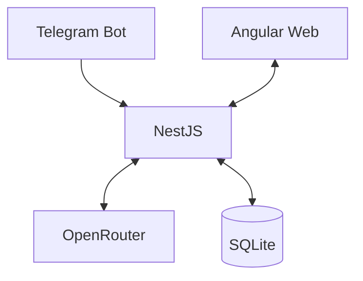

# Plan general de desarrollo — Asistente financiero personal con IA

**Versión:** 0.1 · **Estado:** Plan inicial de alto nivel  
**Propósito:** Documento de arranque para un agente de desarrollo. Los detalles de implementación, contratos y tareas pequeñas se definirán en un plan posterior.

## 1. Visión del producto

Construir una aplicación personal para administrar gastos, ingresos, cuentas, presupuestos, ahorros y objetivos financieros con la menor fricción posible.

La experiencia principal será registrar operaciones en lenguaje natural mediante un bot de Telegram. Una interfaz web permitirá revisar movimientos, saldos, gráficos, presupuestos y progreso de objetivos. La IA interpretará los mensajes, pero las reglas de negocio, cálculos y persistencia serán responsabilidad del backend.

**Contexto prioritario:** uso cotidiano en Venezuela, con operaciones en bolívares (VES), dólares estadounidenses (USD) y USDT. El sistema debe distinguir gastos, ingresos y conversiones entre activos, sin contar dos veces el mismo dinero.

**Enfoque:** primero una herramienta personal funcional y confiable. Se evitarán integraciones y complejidad que no aporten al MVP. La posibilidad de ampliar a varios usuarios se evaluará posteriormente; no se implementará un sistema multiusuario completo ahora.

## 2. Stack y decisiones iniciales

| Componente | Elección inicial | Consideraciones |
|---|---|---|
| Backend | NestJS + TypeScript | Una aplicación modular; sin microservicios. |
| Persistencia | SQLite | Base local, migraciones y copias de seguridad. |
| Acceso a datos | TypeORM | Se prioriza familiaridad y consistencia; confirmar al iniciar el repositorio. |
| Canal de captura | Telegram Bot API | Mensajes de texto en el MVP; fotografías más adelante. |
| Inteligencia artificial | OpenRouter | Modelo configurable por entorno, sin dependencia rígida de un proveedor. |
| Modelo candidato | `qwen/qwen3.5-flash-02-23` | Validar calidad, costo y soporte real de salidas estructuradas antes de fijarlo. |
| Alternativa de comparación | `openai/gpt-6-luna` | Utilizar para pruebas comparativas, no como dependencia obligatoria. |
| Interfaz web | Angular | Panel financiero responsive con visualizaciones. |

La elección de hosting sigue abierta. Para desarrollo local puede utilizarse *long polling* de Telegram; para una instancia permanentemente disponible se evaluará un webhook HTTPS. Mantener la configuración separada del código.

## 3. Experiencia principal

### Captura por Telegram

El usuario escribe mensajes como:

- «Helado 2 dólares».
- «Gasté 3500 Bs en comida».
- «Me pagaron 575 dólares».
- «Cambié 50 USDT por bolívares».

La aplicación interpreta la intención, identifica los datos disponibles, valida y registra la operación. Si faltan datos esenciales —por ejemplo, la moneda o la cuenta afectada— debe pedir una aclaración breve. Se deben poder corregir y anular registros, sin perder trazabilidad básica.

Las categorías serán automáticas y opcionales. Una compra mixta no debe obligar a desglosar todos sus productos.

### Consulta web

El usuario podrá consultar, al menos:

- Gastos e ingresos por período y categoría.
- Movimientos recientes y posibilidad de corregirlos.
- Cuentas y saldos en sus monedas originales.
- Presupuesto disponible en la quincena o mes.
- Progreso de fondos de ahorro y objetivos de compra.
- Evolución financiera mediante gráficos sencillos.

Los gráficos y totales provendrán de cálculos deterministas sobre la base de datos, no de estimaciones generadas libremente por un modelo.

## 4. Principios de dominio que deben respetarse

1. **Una operación no es siempre un gasto.** Distinguir ingresos, gastos, transferencias, saldos iniciales y ajustes de conciliación.
2. **Las transferencias no generan ingresos ni gastos artificiales.** Convertir USDT a bolívares mueve valor entre cuentas; comisiones y diferencias de cambio deben modelarse de forma explícita cuando corresponda.
3. **Conservar el valor original.** Guardar importe, moneda, fecha y datos de conversión aplicables. No reescribir el historial por cambios posteriores de cotización.
4. **Cálculos monetarios exactos.** Evitar `float`/`REAL` como representación de dinero. Definir una estrategia coherente de unidades menores o decimales exactos.
5. **La IA no ejecuta SQL ni modifica saldos directamente.** Produce una intención estructurada; NestJS valida, aplica reglas y persiste mediante operaciones controladas.
6. **No inventar información faltante.** Ante ambigüedades relevantes, solicitar confirmación o registrar una operación pendiente.
7. **Los presupuestos son límites, no cuentas bancarias.** Distinguir dinero disponible, gastos del período y fondos reservados para objetivos.
8. **La información puede ser incompleta.** Permitir conciliación manual de saldos cuando el usuario olvide registrar una compra, identificando claramente los ajustes.

## 5. Arquitectura general

El backend centralizará la lógica financiera y expondrá los servicios que necesiten tanto el bot como la web. La integración con OpenRouter será sustituible por configuración. Evitar capas, abstracciones y componentes que aún no tengan una necesidad concreta.

## 6. Etapas generales de ejecución

### Etapa A — Fundamentos y primer flujo completo

- Inicializar el proyecto y su configuración de desarrollo.
- Definir el modelo mínimo de movimientos y cuentas, con migraciones de SQLite.
- Integrar Telegram y OpenRouter para interpretar mensajes de texto en formato estructurado.
- Implementar validaciones, confirmaciones cuando hagan falta y persistencia sin duplicados.
- Verificar un flujo completo: mensaje → interpretación → validación → registro → respuesta al usuario.

**Resultado:** el usuario puede registrar y consultar operaciones básicas desde Telegram de forma confiable.

### Etapa B — Administración financiera básica

- Incorporar presupuestos por período, cuentas, saldos iniciales, transferencias, categorías, objetivos y reservas de ahorro.
- Incluir edición, anulación y conciliación de movimientos.
- Probar especialmente los casos VES/USD/USDT, transferencias y gastos en distintas monedas.

**Resultado:** el sistema puede calcular gastos, saldos y progreso de objetivos sin doble contabilización.

### Etapa C — Interfaz web

- Crear el panel Angular conectado al mismo backend.
- Mostrar movimientos, saldos, presupuesto restante, objetivos y gráficos básicos.
- Permitir correcciones esenciales desde la web.
- Asegurar el acceso a los datos financieros.

**Resultado:** la información registrada mediante Telegram es visible y verificable en la web.

### Etapa D — Captura avanzada y mejoras

- Incorporar fotografías de facturas con extracción de importe, moneda y comercio.
- Requerir confirmación cuando el reconocimiento sea incierto.
- Evaluar clasificación opcional de artículos, consultas financieras en lenguaje natural y automatizaciones.
- Mejorar reportes, experiencia móvil, exportación y administración de la información.

**Resultado:** reducir aún más la fricción de captura sin comprometer la fiabilidad.

Las etapas son una guía de orden, no una lista cerrada de tareas. Antes de implementar cada etapa se preparará un plan técnico más detallado y se ajustará según lo aprendido.

## 7. Requisitos de seguridad y fiabilidad desde el inicio

- Restringir el bot al usuario autorizado durante la etapa personal.
- Proteger claves de Telegram y OpenRouter en configuración segura; nunca incluir secretos en el repositorio ni en logs.
- Validar mensajes, esquemas de IA y permisos antes de escribir en SQLite.
- Procesar identificadores únicos de eventos de Telegram para impedir duplicados por reintentos.
- Proteger la interfaz web antes de exponerla públicamente.
- Preparar migraciones, backups restaurables y manejo explícito de errores.
- Conservar solo los datos necesarios; evitar persistir fotografías y mensajes sensibles sin una justificación.
- Establecer límites de gasto y seguimiento del costo de inferencia de OpenRouter.
- Probar el cálculo monetario y las transferencias con casos automatizados.

## 8. Fuera del alcance inicial

- Aplicación nativa Android/iOS.
- Sincronización automática con bancos o Binance.
- Inversiones, trading o recomendaciones financieras automatizadas.
- OCR y desglose detallado de facturas en la primera entrega.
- Sistema multiusuario completo, roles empresariales y facturación SaaS.
- Microservicios, colas de mensajes y despliegues distribuidos sin necesidad demostrada.
- Dashboards complejos antes de tener datos consistentes y reales.

## 9. Criterios de éxito del primer MVP

El primer incremento se considerará útil cuando:

1. Un mensaje de texto claro genere exactamente un movimiento correcto, sin registros duplicados.
2. Un mensaje ambiguo pida aclaración y no guarde información inventada.
3. Los datos persistan al reiniciar el backend.
4. Una conversión entre cuentas no aparezca como gasto.
5. El usuario pueda consultar un resumen determinista y corregir un error.
6. Existan pruebas de los invariantes financieros y un procedimiento de copia de seguridad.

El éxito final del producto se medirá además por su **uso real**: registrar una compra debe requerir muy poco esfuerzo y los reportes deben ser lo suficientemente confiables para tomar decisiones.

## 10. Instrucciones para el agente que comenzará el desarrollo

1. Utiliza este documento como dirección general, **no como una especificación técnica exhaustiva**.
2. Examina primero el repositorio, si ya existe, y conserva las convenciones y cambios del usuario.
3. Empieza por la **Etapa A** y busca entregar un flujo vertical mínimo, ejecutable y verificable. No implementes todas las etapas de una sola vez.
4. Antes de codificar, plantea únicamente las preguntas que cambien materialmente el diseño y explicita cualquier suposición restante. Como punto de partida, asume un usuario personal, ejecución local y modelo configurable por OpenRouter.
5. Prioriza KISS, tipado estricto, nombres claros, reglas financieras centralizadas, migraciones y pruebas relevantes.
6. No permitas que la IA escriba directamente en la base de datos ni que genere cifras para sustituir consultas reales.
7. Informa al terminar cada incremento qué funciona, qué fue verificado, qué falta y qué decisiones quedaron pendientes.
8. Solicita un plan detallado antes de ampliar considerablemente el alcance.

## 11. Decisiones abiertas para la siguiente planificación

- Ubicación definitiva de ejecución y disponibilidad 24/7.
- Estrategia precisa para tasas de cambio y valoración de patrimonio.
- Contratos de entrada/salida de la IA y estados de confirmación.
- Esquema de cuentas, transacciones, transferencias y objetivos.
- Autenticación web y política de conservación de datos.
- Elección definitiva del modelo tras pruebas con frases reales.
- Alcance y método de OCR de facturas.

## 12. Estado de verificación (Etapa A)

Este registro **no cambia el alcance** del plan: solo deja por escrito qué está verificado
hoy y qué queda pendiente. La Etapa A tiene **aceptación técnica local del código** —el
código y las pruebas automáticas están hechos, revisados y en verde—, con **verificación
operativa pendiente**: siguen abiertas la validación del modelo, la prueba contra los
servicios reales, la ejecución en Node 24 y la revisión de preparación para producción.
**Una revisión local no equivale a producción.**

| Punto de la Etapa A | Estado | Cómo se comprobó |
| --- | --- | --- |
| Contexto ejecutable, cuentas, movimientos y migraciones | Verificado | Pruebas de migración, de importes exactos y de reapertura de la base |
| Interpretación estructurada (OpenRouter) | Verificado contra un `fetch` simulado | Pruebas del interpretador: esquema estricto, JSON inválido, estado de error, tiempo agotado, respuesta desmedida, fallo de lectura |
| Captura durable y `/confirm` obligatorio | Verificado | Pruebas de la captura: nada se registra antes de confirmar, evento repetido que no vuelve a interpretar, movimiento único |
| Ciclo del bot en tres pasos (aceptar, procesar, entregar) | **Corregido y verificado** | Pruebas del servicio de sondeo: actualización que no se procesa se conserva, bloquea a las siguientes de su chat y el bot sigue sondeando y entregando |
| Orden durable del pendiente | **Corregido y verificado** | Todo el procesamiento sale de la lectura ordenada de lo pendiente: un `/confirm` nuevo no se procesa si no se puede leer lo pendiente, y al recuperarse se registra la corrección y no el borrador viejo; con la lectura o la limpieza de lo revocado fallando no se procesa nada |
| Orden de entrega por chat | **Corregido y verificado** | Pruebas de la bandeja de salida: una entrega retrasada o transitoriamente fallida no se adelanta; al recuperar se entrega en orden |
| Espera de reintento de procesamiento separada de la del sondeo | **Corregido y verificado** | Prueba que mide el intervalo entre reintentos con el sondeo funcionando |
| Error persistente de entrega o de persistencia | **Corregido y verificado** | Pruebas de un fallo puntual de la bandeja de salida (el ciclo sigue) y de un fallo al crearla (la respuesta se reproduce sin repetir la inferencia) |
| Revocación: limpieza transaccional de lo no autorizado | **Corregido y verificado** | Pruebas de revocación: se descarta lo pendiente, no se toca lo registrado y un chat reautorizado no puede confirmar |
| Procedencia del borrador (mismo chat, otro usuario) | **Corregido y verificado** | El borrador se cancela por su origen en Telegram (clave estable ligada a la actualización que lo creó), no solo por su chat: un `/confirm` del usuario nuevo no registra el borrador del anterior, y las filas históricas de otro usuario no cancelan el borrador nuevo del usuario vigente |
| `/usage` determinista | **Añadido y verificado** | Pruebas del comando: día de Caracas vacío, con consumo, con el límite alcanzado y con el cambio de día sin modificar el estado |
| Privacidad: texto borrado, sin secretos ni mensajes en los registros | Verificado | Pruebas de la bandeja de entrada y de salida, y de los mensajes de error |
| Cerrojo de una sola instancia | Exclusión entre procesos verificada | Pruebas del cerrojo, incluida una con un proceso limpio; la recuperación de un cerrojo obsoleto sigue siendo manual |
| Llamadas HTTP acotadas | **Corregido y verificado** | Pruebas de la llamada acotada: cancelación normal, rechazada y colgada, tiempo agotado y cancelación externa sin éxito parcial |
| Modelo con frases reales | **Pendiente del operador** | Tarea manual: elegir el modelo y comprobarlo con el proveedor |
| Telegram real y OpenRouter real | **No verificado** | Ninguna prueba hace llamadas externas ni usa credenciales reales |
| Node 24 (lo exige `package.json`) | **No verificado** | La suite se ejecutó en Node 22.22.3, la única versión disponible en el entorno |
| Revisión de preparación para producción | **No hecha** | Requiere una revisión del código con criterio de seguridad |

### Evidencia de la aceptación técnica local (2026-11-10)

| Comprobación | Resultado |
| --- | --- |
| Revisión final del código | Sin hallazgos: «No issues found, OK» |
| `npm run typecheck` | Sin errores de tipos |
| `npm run build` | Compilación correcta |
| `npm test -- --runInBand` | 15 suites y 184 pruebas, todas en verde |
| `npm run test:e2e -- --runInBand` | 7 pruebas, todas en verde |
| `git diff --check` | Limpio |

Entorno de la comprobación: Node 22.22.3 (2026-11-10). Esto acredita el **código** de la
Etapa A en local, **no la habilitación operativa**: los puntos «Modelo con frases reales»,
«Telegram real y OpenRouter real», «Node 24» y «Revisión de preparación para producción»
de la tabla anterior siguen abiertos.

La Etapa B no se inició en este incremento porque la auditoría inicial encontró
correcciones de la Etapa A pendientes de implementar.

## Referencias técnicas oficiales

- [Telegram Bot API](https://core.telegram.org/bots/api)
- [Structured Outputs de OpenRouter](https://openrouter.ai/docs/guides/features/structured-outputs)
- [NestJS y TypeORM](https://docs.nestjs.com/data/typeorm)
- [SQLite y WAL](https://www.sqlite.org/wal.html)

---

**Nota de alcance:** Este plan no incluye los saldos, ingresos ni deudas personales del usuario. Esas cifras deben configurarse después como datos privados de la aplicación, no codificarse ni colocarse en fixtures públicos.
